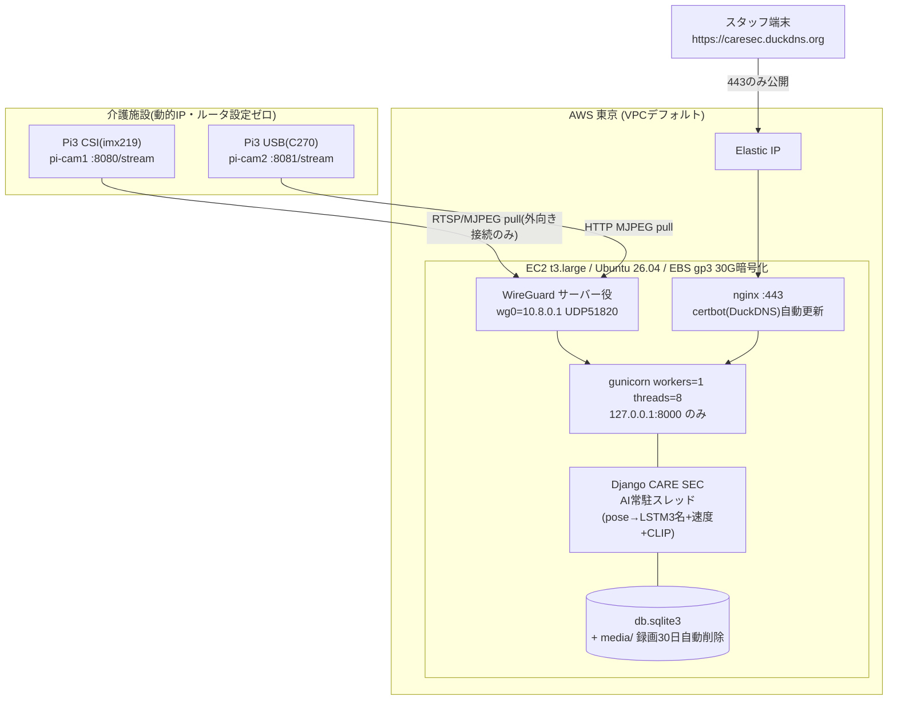

# CARE SEC AWS構成図(実装済み 2026-11-26)

> 旧版の「t3.small+S3+django-encrypted-sqlite+施設GW/VPN」案は**不採用**で、
> 実際は下の構成で稼働している。設計詳細は `AWS Setup Guide.html`、
> 実走手順は `AWS移行成功手順.html`。

## 稼働構成

## セキュリティグループ(実設定)

| ポート | 送信元 | 用途 |
|---|---|---|
| TCP 80 | 0.0.0.0/0 | httpsへ301のみ |
| TCP 443 | 0.0.0.0/0 | 唯一の公開窓口(TLS) |
| TCP 22 | 自分のIP/32 | SSH(Session Manager化で閉じる予定) |
| UDP 51820 | 0.0.0.0/0 | WireGuard(鍵認証済みしか通らない) |
| ~~8554/RTSP~~ | — | **開いていない**(映像はトンネル内のみ) |

## データフロー要点

1. 映像は**Piが外へ出る接続のみ**でEC2に入る(施設にポート開放なし・動的IPはWGが追従)
2. ai2は `Camera.stream_url=http://10.8.0.2:80xx/stream` を専有スレッドでpull(最新1枚保持・遅延0.03秒実測)
3. 検知→Alert→録画→`media/`。**ログイン済みユーザーだけが `/media` を閲覧可能**(protected_media)
4. 録画は30日でDB行+ファイルごと自動削除(一覧は残り日数のみ表示)

## コスト実勢(東京・概算)

| 項目 | 月額 |
|---|---|
| t3.large 常時稼働 | ¥12,000〜14,000(1年予約で約4割減可) |
| EBS gp3 30G+スナップショット | ¥500前後 |
| EIP(紐付け中) / DuckDNS / certbot | ¥0 |
| **合計** | **約¥13,000〜** |

## 旧案が不採用になった理由(記録)

- t3.small(2GB)は TF+torch(CLIP)+MediaPipe同居で**不可**(実RSS 4〜5GB→t3.large要)
- S3 Presigned配信は「URL知る人誰でも」リスクの回避設計が別途必要→EBS+認証配信で十分
- django-encrypted-sqliteは**未実装**(暗号化はEBSスナップショットレベル。DB暗号化は要件が出たら)
- 施設GW/VPN(IPsec)は月¥3,600+ルータ設定が必要→WireGuard/既存Pi配信で代替
