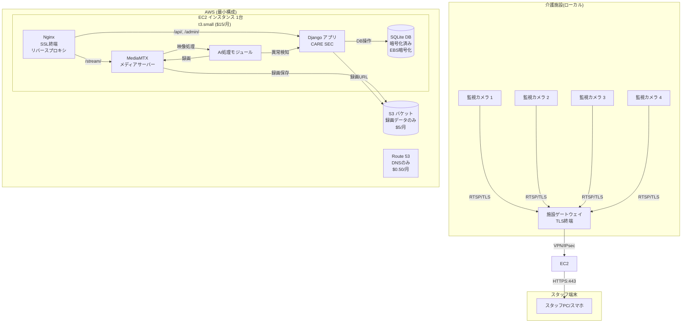
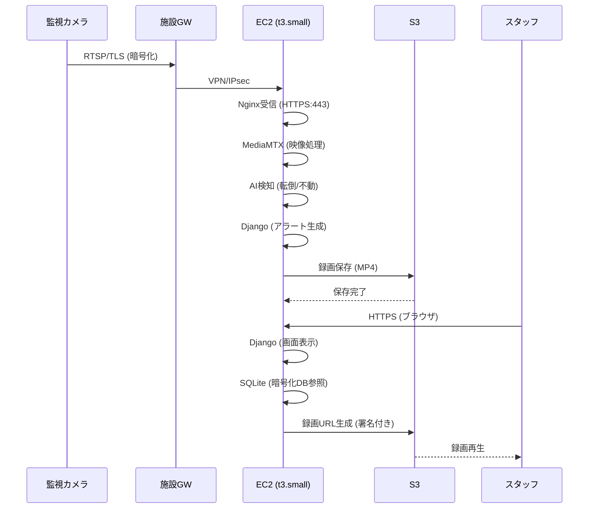

# CARE SEC AWS構成図(コスト最適化版)

## システム構成図



---

## データフロー図



---

## コスト構成

| リソース | 仕様 | 月額 |
|---|---|---|
| EC2 | t3.small (2vCPU, 2GB) | $15 |
| EBS | 20GB gp3 (暗号化) | $2 |
| S3 | Standard (録画) | $5 |
| Route 53 | ホストゾーン | $0.50 |
| **合計** | - | **約$22.50/月** |

---

## 暗号化構成

```
[SQLite DBファイル]
    ↓ django-encrypted-sqlite で暗号化
[暗号化DBファイル]
    ↓ EBSボリューム暗号化(AES-256)
[AWSディスク上]
```
