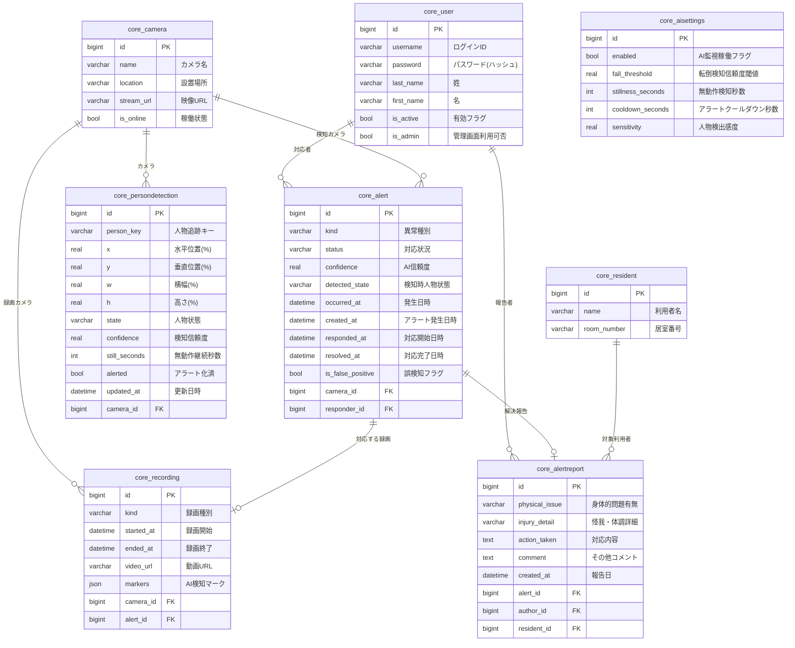
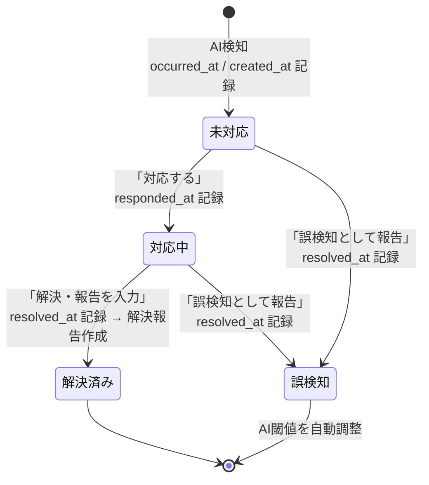

# CARE SEC テーブル設計書

| 項目 | 内容 |
|---|---|
| システム名 | CARE SEC 転倒・異常検知システム |
| 文書名 | DBテーブル設計書 |
| 版 | 1.0 |
| 作成日 | 2026-10-22 |
| DBMS | SQLite 3 (Django 6.1.2 / Python 3.13) |
| 文字コード | UTF-8 |

---

## 1. 命名規則

| 区分 | 規則 | 例 |
|---|---|---|
| 物理テーブル名 | `アプリ名_テーブル名(snake_case)` | `core_alert` |
| 物理カラム名 | snake_case / 外部キーは `親テーブル名_子要素名` | `camera_id` |
| 論理テーブル名 | 業務領域で「このデータを何と呼ぶか」 | 異常検知記録 |
| 論理カラム名 | 画面・帳票での表示名 | 対応開始日時 |
| 日時カラム | 業務発生時点を `xxx_at`、システム生成時点を `created_at` | `occurred_at` / `created_at` |
| フラグ | `is_xxx` / `xxx_enabled` | `is_false_positive` |
| コード値 | 英語snake_case、値は `models.TextChoices` で一元管理 | `false_positive` |

---

## 2. テーブル一覧

### 2.1 業務データ(本システム)

| # | 物理名 | 論理名 | 概要 | 現件数 |
|---|---|---|---|---|
| 1 | `core_user` | **介護士アカウント** | システムを利用する介護士(スタッフ)の認証情報 | 3 |
| 2 | `core_camera` | **監視カメラ** | 施設内に設置された監視カメラの台帳 | 4 |
| 3 | `core_resident` | **介護施設利用者** | 見守り対象の入居者名簿 | 6 |
| 4 | `core_alert` | **異常検知記録** | AIが検知した異常アラートの実体(中核) | 8 |
| 5 | `core_recording` | **自動録画** | 異常検知の前後を自動で保存した映像 | 4 |
| 6 | `core_alertreport` | **解決報告** | 対応完了後に介護士が記録する報告 | 2 |
| 7 | `core_persondetection` | **人物検知状態(ライブ)** | カメラに映っている人物の現在のAI解析状態 | 65 |
| 8 | `core_aisettings` | **AI検知設定** | AIの判定基準(シングルトン) | 1 |

### 2.2 フレームワーク管理用(Django内部)

| # | 物理名 | 論理名 | 概要 | 現件数 |
|---|---|---|---|---|
| 9 | `django_content_type` | モデル種別マスタ | 全モデルの登録簿(管理画面ログの参照先) | 13 |
| 10 | `auth_permission` | 権限マスタ | Django内部の権限定義(当システムの判定には不使用) | 20 |
| 11 | `django_admin_log` | 管理操作履歴 | 管理画面での変更履歴 | 1 |
| 12 | `django_session` | セッション | ログイン状態 | 8 |
| 13 | `django_migrations` | マイグレーション履歴 | 適用済みマイグレーションの記録 | 19 |

---

## 3. ER図



---

## 4. テーブル詳細

> **桁数(column length)の扱い**: 本章の「型」欄に `varchar(N)` / `text` と実効桁数を示す。
> 详细については **§8 桁数設計方針** を参照。

### 4.1 介護士アカウント `core_user`

**目的**: システムログインと、異常の対応者・報告者としての本人識別。権限(グループ)機能は持たない。

| 物理名 | 論理名 | 型 | NULL | キー | 説明 |
|---|---|---|---|---|---|
| `id` | 介護士ID | INTEGER | NOT | PK | 内部採番 |
| `username` | ログインID | varchar(150) | NOT | UNIQUE | 施設管理者から発行するアカウント名 |
| `password` | パスワード | varchar(128) | NOT | | PBKDF2ハッシュ(平文は保持しない) |
| `last_name` | 姓 | varchar(50) | NOT | | 介護士名(姓) |
| `first_name` | 名 | varchar(50) | NOT | | 介護士名(名) |
| `email` | メールアドレス | varchar(254) | NOT | | 連絡用(任意) |
| `is_active` | 有効フラグ | bool | NOT | | FALSEでログイン不可(アカウント停止) |
| `is_admin` | 管理画面利用可否 | bool | NOT | | TRUEなら管理画面も操作可 |
| `last_login` | 最終ログイン日時 | datetime | NULL | | 最終ログイン時刻 |
| `date_joined` | 登録日 | datetime | NOT | | アカウント発行日 |

> **注**: `is_superuser` / `groups` / `user_permissions` は**意図的に存在しない**。介護士のみの使用を前提に権限機能を撤去した。

---

### 4.2 監視カメラ `core_camera`

**目的**: 監視カメラの台帳。異常検知・自動録画・人物検知のすべてがカメラに紐づく。

| 物理名 | 論理名 | 型 | NULL | キー | 説明 |
|---|---|---|---|---|---|
| `id` | カメラID | INTEGER | NOT | PK | 内部採番 |
| `name` | カメラ名 | varchar(64) | NOT | | 識別名(CAM-01等) |
| `location` | 設置場所 | varchar(128) | NOT | | 1F廊下、1F食堂等 |
| `stream_url` | 映像ストリームURL | text | NOT | | 実カメラ接続時のURL(未使用なら空) |
| `is_online` | 稼働状態 | bool | NOT | | FALSEのカメラはAI解析対象外 |

---

### 4.3 介護施設利用者 `core_resident`

**目的**: 入居者の名簿。解決報告で「誰だったか」を特定するためのマスタ。

| 物理名 | 論理名 | 型 | NULL | キー | 説明 |
|---|---|---|---|---|---|
| `id` | 利用者ID | INTEGER | NOT | PK | 内部採番 |
| `name` | 利用者名 | varchar(64) | NOT | | 氏名 |
| `room_number` | 居室番号 | varchar(16) | NOT | | 101号室等 |
| `created_at` | 登録日 | datetime | NOT | | 登録日時 |

---

### 4.4 異常検知記録 `core_alert` ★中核

**目的**: AIが検知した異常のアラート実体。対応状況のワークフロー(未対応→対応中→解決済み/誤検知)を这里で管理し、検知情報と時刻ログを保持する。

| 物理名 | 論理名 | 型 | NULL | キー | 説明 |
|---|---|---|---|---|---|
| `id` | 異常検知ID | INTEGER | NOT | PK | 内部採番 |
| `kind` | 異常種別 | varchar(16) | NOT | | 転倒/あやしい動き/立ち入り禁止ゾーン(§5.1) |
| `status` | 対応状況 | varchar(16) | NOT | | 未対応/対応中/解決済み/誤検知(§5.2) |
| `confidence` | AI信頼度 | REAL | NULL | | 0.0〜1.0。AIの判定確度 |
| `detected_state` | 検知時人物状態 | varchar(16) | NOT | | 立っている/座っている/横たわっている/不明(§5.3) |
| `occurred_at` | 発生日時 | datetime | NOT | | 異常が発生した実際の時刻 |
| `created_at` | アラート発生日時 | datetime | NOT | | システム(student)がアラートを生成した時刻 |
| `responded_at` | 対応開始日時 | datetime | NULL | | 介護士が「対応する」を押した時刻 |
| `resolved_at` | 対応完了日時 | datetime | NULL | | 解決または誤検知として確定した時刻 |
| `is_false_positive` | 誤検知フラグ | bool | NOT | | TRUE=誤検知として登録済み |
| `thumbnail_url` | 検知時画像URL | text | NOT | | 検知瞬間のサムネイル |
| `camera_id` | 検知カメラID | bigint | NOT | FK | 発生场所のカメラ |
| `responder_id` | 対応介護士ID | bigint | NULL | FK | 対応を引き受けた介護士 |

> **時刻ログの4段階**: `occurred_at`(発生) → `created_at`(アラート) → `responded_at`(対応開始) → `resolved_at`(完了)。
> 差分から「検知から対応までの時間」「対応所要時間」を算出可能。

---

### 4.5 自動録画 `core_recording`

**目的**: AIが異常を検知した際、検知前10秒〜後35秒を自動保存した映像と、その中のAI検知マーク。

| 物理名 | 論理名 | 型 | NULL | キー | 説明 |
|---|---|---|---|---|---|
| `id` | 録画ID | INTEGER | NOT | PK | 内部採番 |
| `kind` | 録画種別 | varchar(16) | NOT | | 転倒の瞬間/あやしい場面(§5.4) |
| `started_at` | 録画開始日時 | datetime | NOT | | 録画開始(検知前) |
| `ended_at` | 録画終了日時 | datetime | NOT | | 録画終了(検知後) |
| `video_url` | 動画URL | text | NOT | | S3等の保存先URL(署名付きで500〜1,000文字) |
| `thumbnail_url` | サムネイルURL | text | NOT | | 一覧表示用画像 |
| `reason` | 録画理由 | varchar(255) | NOT | | 「AIが異常を検知したため自動録画」等 |
| `markers` | AI検知マーク | JSON | NOT | | `[{"seconds":18,"label":"転倒の瞬間"}]` 形式 |
| `camera_id` | 録画カメラID | bigint | NOT | FK | 録画したカメラ |
| `alert_id` | 関連異常検知ID | bigint | NULL | FK | 対応する異常検知(1:1) |

---

### 4.6 解決報告 `core_alertreport`

**目的**: 対応完了後、介護士が記録する報告(誰だったか/身体的問題/対応内容/コメント)。

| 物理名 | 論理名 | 型 | NULL | キー | 説明 |
|---|---|---|---|---|---|
| `id` | 報告ID | INTEGER | NOT | PK | 内部採番 |
| `physical_issue` | 身体的問題有無 | varchar(16) | NOT | | なし/あり(疑い)/あり(確認)/不明(§5.5) |
| `injury_detail` | 怪我・体調詳細 | varchar(255) | NOT | | 具体的な症状(自由記述) |
| `action_taken` | 対応内容 | TEXT | NOT | | 起こし介助、バイタル測定など |
| `comment` | その他コメント | TEXT | NOT | | 追加記録・申し送り |
| `created_at` | 報告日 | datetime | NOT | | 報告登録日時 |
| `alert_id` | 対象異常検知ID | bigint | NOT | FK | 報告対象の異常(1:1) |
| `author_id` | 報告介護士ID | bigint | NOT | FK | 報告者本人 |
| `resident_id` | 対象利用者ID | bigint | NULL | FK | 該当した入居者(不明ならNULL) |

---

### 4.7 人物検知状態(ライブ) `core_persondetection`

**目的**: カメラに映っている人物の現在のAI解析状態。姿勢遷移・無動作時間・信赖度の積算元であり、異常検知の入力。人物が映らなくなると削除される**揮発性テーブル**。

| 物理名 | 論理名 | 型 | NULL | キー | 説明 |
|---|---|---|---|---|---|
| `id` | 検知ID | INTEGER | NOT | PK | 内部採番 |
| `person_key` | 人物追跡キー | varchar(32) | NOT | | フレーム間で同一人物を区別する匿名ID |
| `x` | 水平位置 | REAL | NOT | | 画面左端からの割合(%) |
| `y` | 垂直位置 | REAL | NOT | | 画面上端からの割合(%) |
| `w` | 横幅 | REAL | NOT | | 枠の横幅(%) |
| `h` | 高さ | REAL | NOT | | 枠の高さ(%) |
| `state` | 人物状態 | varchar(16) | NOT | | 立っている/座っている/横たわっている/不明(§5.3) |
| `confidence` | 検知信頼度 | REAL | NOT | | 0.0〜1.0 |
| `still_seconds` | 無動作継続秒数 | INTEGER | NOT | | 無動作検知秒数の閾値を超えると「あやしい動き」と判定 |
| `alerted` | アラート化済フラグ | bool | NOT | | TRUE=この人物から既的产生済み(連発防止) |
| `updated_at` | 更新日時 | datetime | NOT | | 最終検知時刻(停滞検知にも使用) |
| `camera_id` | カメラID | bigint | NOT | FK | 映っているカメラ |

> **プライバシー配慮**: 顔画像・個人識別情報は保持せず、矩形の座標と姿勢のみを保持する。

---

### 4.8 AI検知設定 `core_aisettings`

**目的**: AIの判定基準を保持する設定(1行のみ保持するシングルトン)。誤検知報告に応じて**自動調整**される自己改善ループの核。

| 物理名 | 論理名 | 型 | NULL | キー | 説明 |
|---|---|---|---|---|---|
| `id` | 設定ID | INTEGER | NOT | PK | 常に1 |
| `enabled` | AI監視稼働フラグ | bool | NOT | | FALSEでAI解析を全面停止 |
| `fall_threshold` | 転倒検知信頼度閾値 | REAL | NOT | | この値以上の信頼度で転倒と判定(誤検知報告で+0.02) |
| `stillness_seconds` | 無動作検知秒数 | INTEGER | NOT | | この時間動かないと異常判定(誤検知報告で+5秒) |
| `cooldown_seconds` | アラートクールダウン秒数 | INTEGER | NOT | | 同一カメラで次アラートを出すまでの最小間隔 |
| `sensitivity` | 人物検出感度 | REAL | NOT | | 0.0〜1.0。高いほど人物を検出しやすい |

---

### 4.9 フレームワーク管理用テーブル

| 物理名 | 論理名 | 用途 | 削除可否 |
|---|---|---|---|
| `django_content_type` | モデル種別マスタ | 全モデルの登録簿。`django_admin_log` のFK先 | ❌ 削除不可 |
| `auth_permission` | 権限マスタ | Django内部の権限定義。`migrate` 実行時に自動再生成される | ❌ 削除不可(実測で `migrate` が失敗) |
| `django_admin_log` | 管理操作履歴 | 管理画面での変更履歴(誰が何を編集したか) | 保持推奨 |
| `django_session` | セッション | ログイン状態の保持 | 必須 |
| `django_migrations` | マイグレーション履歴 | 適用済みmigrationの記録 | 必須 |

> `auth_group` / `auth_group_permissions` は**権限機能廃止により未使用となったため削除済み**。

---

## 5. コード値定義

### 5.1 異常種別 `core_alert.kind`

| 値 | 論理名称 | 説明 |
|---|---|---|
| `fall` | 転倒 | 人物が倒れた |
| `suspicious` | あやしい動き | 無動作・不審な挙動 |
| `zone` | 立ち入り禁止ゾーン | 立入禁止区域への侵入 |

### 5.2 対応状況 `core_alert.status`

| 値 | 論理名称 | 説明 | 遷移先 |
|---|---|---|---|
| `open` | 未対応 | 検知直後。要介護士が対応 | `responding` / `false_positive` |
| `responding` | 対応中 | 対応者が確定。現場対応中 | `resolved` / `false_positive` |
| `resolved` | 解決済み | 対応完了・報告入力済 | (終端) |
| `false_positive` | 誤検知 | AIの誤判定と確定。対応不要 | (終端) |

### 5.3 人物状態 `core_alert.detected_state` / `core_persondetection.state`

| 値 | 論理名称 | 説明 |
|---|---|---|
| `standing` | 立っている | 正常な歩行・起立状態 |
| `sitting` | 座っている | 椅子・ベッドでの待機状態 |
| `lying` | 横たわっている | 転倒・床上臥臥状態 |
| `unknown` | 不明 | 判定不能・信頼度不足 |

### 5.4 録画種別 `core_recording.kind`

| 値 | 論理名称 | 説明 |
|---|---|---|
| `fall` | 転倒の瞬間 | 転倒を検知して保存した映像 |
| `suspicious` | あやしい場面 | あやしい動き/侵入を検知して保存した映像 |

### 5.5 身体的問題 `core_alertreport.physical_issue`

| 値 | 論理名称 | 説明 |
|---|---|---|
| `none` | なし | 身体的問題は確認されなかった |
| `suspected` | あり(疑い) | 疑いがあるが断定できない |
| `confirmed` | あり(確認) | 确定为認めた |
| `unknown` | 不明 | 判断できなかった |

---

## 6. データライフサイクル

```
【監視カメラ】1 ──< 【異常検知記録】1 ──1 【自動録画】
                        │
                        └──1 【解決報告】──< 【介護施設利用者】
                                        └──< 【介護士アカウント】

【監視カメラ】1 ──< 【人物検知状態(ライブ)】  ※人物消滅で自動削除
【AI検知設定】1   ※誤検知報告で自動調整(自己改善ループ)
```

### 異常検知記録の状態遷移と時刻記録



---

## 7. 将来拡張メモ

| テーマ | 候補 |
|---|---|
| 長期保存 | 異常検知記録・自動録画の保持期間設定(例: 30日経過で anonymize / 削除) |
| 多施設 | `core_camera` に施設IDを付与、`core_user` に所属施設を付与 |
| 利用者紐付け | カメラ映像と利用者を紐付ける場合(tracking ID と居室の対応表)を新設 |
| 通知履歴 | OS通知の送信履歴(誰がいつ通知を受けたか)を新設 |
| 監査 | 対応開始・完了の操作者・操作IPを `django_admin_log` 任せにせず自前のテーブルで保持 |

---

## 8. 桁数設計方針

### 8.1 カテゴリ別の桁数基準

| カテゴリ | 採用型 | 桁数 | 根拠 |
|---|---|---|---|
| コード値(enum) | `varchar(16)` | 16 | 最も長い値 `false_positive`(14文字)に対し将来の拡張余地を残して16 |
| 名称(短文) | `varchar(64)` | 64 | カメラ名・利用者名など |
| 名称(長文/住所) | `varchar(128)` | 128 | 設置場所など |
| 識別子(コード) | `varchar(16)`〜`varchar(32)` | - | 部屋番号・人物追跡キー |
| 名称(人名) | `varchar(50)` | 50 | 姓/名。日本語氏名として十分 |
| ログインID | `varchar(150)` | 150 | Django標準値。互換性のため変更しない |
| メールアドレス | `varchar(254)` | 254 | RFC 5321の最大長 |
| パスワード(hash) | `varchar(128)` | 128 | PBKDF2ハッシュ長(固定) |
| 自由記述(長) | `text` | 無制限 | 対応内容・コメント・AI検知マーク(JSON) |
| **URL系** | **`text`** | **無制限** | **S3のPresigned URL(署名付き)は500〜1,000文字** |

### 8.2 URL系を text にした理由(重要)

本系统在 AWS S3 に録画データを保存する前提のため、録画・画像・ストリームのURLには
**署名付きURL(Presigned URL)** を保存する必要がある。

| URL種別 | 長さの目安 |
|---|---|
| S3 Presigned URL | 500〜1,000文字 |
| CloudFront + 署名付き | 300〜800文字 |
| 内部パス指定URL | 100文字程度 |

`varchar(255)` のままだと本番で**確実に超過**し、PostgreSQL移行時に
`value too long for type character varying(255)` で突然失敗するため `text` へ変更した。

### 8.3 SQLite 固有の注意(重要)

> **SQLiteでは `varchar(N)` の上限が強制されない。** Nは「長さのヒント」であり、
> 実際の制約は `TEXT` と同じである。

つまり **SQLiteでテスト中は桁数超過が静かに通ってしまう**。エラーとして現れるのは
PostgreSQL 等へ移行した本番環境で、`INSERT` 時に即座に失敗する。

このため、桁数は「テストでnoticedしない値」ではなく「**本番で発生しうる最大値**」を
基準に設計する必要がある。定期的(本番切替前)に実データ長を計測し、
定義桁数の 70% を超えるカラムがないか確認することを推奨する。

### 8.4 実データ長との対比(2026-10-22 計測)

| カラム | 定義桁数 | 実データ最大長 | 使用率 | 備考 |
|---|---|---|---|---|
| `core_user.username` | 150 | 6 | 4% | Django標準 |
| `core_user.first_name` / `last_name` | 50 | 2 | 4% | |
| `core_user.email` | 254 | 0 | 0% | 未入力 |
| `core_user.password` | 128 | 89 | 70% | PBKDF2ハッシュ。**70%到達・要監視** |
| `core_camera.name` | 64 | 6 | 9% | |
| `core_camera.location` | 128 | 7 | 5% | |
| `core_camera.stream_url` | text | 0 | - | 未使用 |
| `core_resident.name` | 64 | 5 | 8% | |
| `core_resident.room_number` | 16 | 3 | 19% | |
| `core_alert.kind` | 16 | 10 | 62% | 最長値 `suspicious` |
| `core_alert.status` | 16 | 10 | 62% | 最長値 `responding` |
| `core_alert.detected_state` | 16 | 7 | 44% | |
| `core_alert.thumbnail_url` | text | 32 | - | 内部パス |
| `core_recording.kind` | 16 | 10 | 62% | |
| `core_recording.video_url` | text | 42 | - | 本番は500〜1,000 |
| `core_recording.thumbnail_url` | text | 32 | - | |
| `core_recording.reason` | 255 | 16 | 6% | |
| `core_recording.markers` | text | 151 | - | JSON |
| `core_alertreport.physical_issue` | 16 | 9 | 56% | |
| `core_alertreport.injury_detail` | 255 | 11 | 4% | |
| `core_alertreport.action_taken` | text | 19 | - | |
| `core_alertreport.comment` | text | 22 | - | |
| `core_persondetection.person_key` | 32 | 14 | 44% | |
| `core_persondetection.state` | 16 | 8 | 50% | |

**注意点2つ**

1. **コード値の最長は `false_positive`(14文字)**。現在該当する行がないため実測最大値は
   `kind`/`status` とも10文字ですが、誤検知が登録されると14文字となります。
   `varchar(16)` に対し87%になるため、**新たなコード値を追加する際は 16 → 32 を見直す**こと。

2. **`core_user.password` が70%到達**。PBKDF2-SHA256(反復150万回)のハッシュ長89文字が
   `varchar(128)` に対し70%。Djangoの既定ハッシャが変わると128文字を超える可能性があるため、
   **Django既定値に合わせて 128 を維持**し、必要なら `text` に変更する。

### 8.5 桁数変更の手順

1. `core/models.py` の `max_length` を変更
2. `python manage.py makemigrations core`
3. `python manage.py migrate`
4. `テーブル設計書.md` の該当行(型欄)を更新
5. 長期間の値が入るカラム(URL等)は `text` への変更を検討

> SQLite→PostgreSQL移行時は、`text` カラムで問題なし。
> 一方 `varchar(N)` は PostgreSQL で上限が効くため、**移行前に上限チェック**を行うこと。
